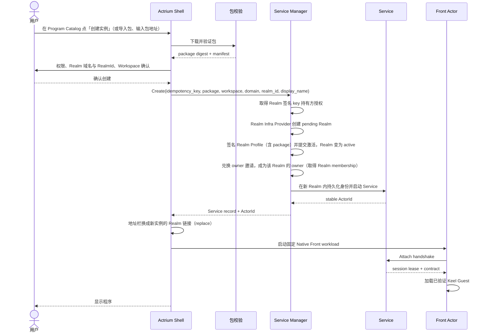

# 03. 用户体验

## 1. 信息架构

Actrium 的一级产品面由五部分组成：

```text
Actrium Shell
├── Tab 与地址栏
├── Program Catalog（程序库）
├── Service Inventory（实例库）
├── Realm & Identity（身份与网络）
└── Security Center（权限、风险、撤销与审计）
```

### 1.1 Program Catalog

回答「我可以运行什么」：

- 已安装程序；
- Marketplace 收藏或推荐；
- Publisher 直接来源；
- 本地导入和开发程序；
- 每个程序已知版本、digest、来源与更新状态。

### 1.2 Service Inventory

回答「我已经创建了什么」：

- 实例地址（Realm 链接）与 Realm 名；
- 程序和精确版本；
- Workspace 显示名；
- Local/Remote 运行位置；
- 生命周期、可达性、健康度和会话占用四组独立状态；
- 最近打开时间和当前 Tab；
- 启动、停止、打开、导出链接、迁移、归档、移入回收站和彻底清除等操作。

Program 与 Service 必须在 UI 和数据模型中分开。安装一个程序不等于已经创建实例；删除程序缓存也不等于删除 Workspace。

## 2. 地址栏

地址栏显示的是实例地址（Realm 链接，见 [04](04-uri-and-resolution.zh.md)），回答三个问题：

| 信息 | 来源 | 用户问题 |
|---|---|---|
| Realm 名 | 地址本身（`actr://<Realm 域名>/<realm_id>`） | 这是哪个实例？信任根是谁？ |
| 程序（Publisher、程序名、版本） | Realm Profile 所指包的 manifest | 这个实例运行的是谁发布的哪个版本？ |
| 页面路径 | 地址中 RealmId 之后的部分 | 我在应用里的哪一页？ |

### 2.1 安全指示

地址栏左侧安全控件必须显示：

- 当前应用保障：绿 / 黄 / 红，或正在重新验证；
- Publisher 域名及 verified/development/revoked 状态；
- 当前 package digest 的短指纹；
- Realm 名及其 Realm 域名；Realm 域名等于或属于 Realm Infra Provider ID 时标明信任根是该 Realm Infra Provider，否则信任根是该 Realm 域名；
- Service 连接状态：local、P2P、TURN relayed、offline；
- 当前权限是否有高风险授权。

不得只用一个含义模糊的「锁」图标把 TLS、包安全、Actor 身份和权限混在一起。

只有 `Ready` 且应用结论为 `CONTROLLED` 才能显示绿色。黄不等于已知泄露，但同样不能显示绿色。挂起或切面过期时显示「正在重新验证 / 通信已阻断」。点击必须能看到当前策略、Actor 数、workload 种类、声明出口、最弱项、所信验证者和结论有效期。

### 2.2 新建与打开的可见差异

- 新建实例在 Shell 的新建页完成，页面显示「将创建新实例」和新 Realm 所在的域名；新建页不对应任何链接，不能被收藏或分享。
- 打开链接时显示实例名（`display_name`）与 Realm 名，提示「打开现有实例」。
- 新建完成后地址栏立即变成新实例的规范化地址。
- 打开失败时地址栏保持原地址。

## 3. 首次启动

Actrium 首次启动完成以下配置：

1. 在 OS 安全存储中初始化 Actrium 密钥存储（用于生成各 Realm 客户端 key）；
2. 随机生成 `installation-id`，本机 Realm 使用伪域名 `<installation-id>.actr.alt`；
3. 设置默认新建位置为「本机」，即新实例使用本机 Realm；
4. 允许用户稍后信任某个 Realm 域名，或通过 Realm 邀请加入其他实例的 Realm；
5. 展示 Program Catalog 和 Service Inventory 的区别；
6. 默认关闭匿名遥测和开发模式。

首次启动不创建任何 Realm；每个本机实例在创建时获得自己的本机 Realm。本机 Realm 允许离线运行本机 Front 与 Service，但其地址只在该 Actrium 安装内可解析。跨设备连接需要先把实例迁移到 Realm 域名下的新 Realm，得到新的地址。

## 4. 安装程序

### 4.1 从 Marketplace

1. 用户打开程序详情；
2. Actrium 显示 Publisher、版本、digest、权限、Workspace 模式和市场审核状态；
3. Actrium 按 Marketplace 或 Publisher 给出的包地址下载 `.actr`；
4. 校验 HTTPS、Publisher key、包签名、digest、兼容性和压缩包限制；
5. 记录 Program Release；
6. 只缓存程序，不自动创建 Service，除非用户点击「创建实例」。

下载地址不是信任源；Actrium 以包签名（经 Publisher Profile 验证）和 digest 为准。

### 4.2 打开链接时

包尚未安装时按 [04 §3](04-uri-and-resolution.zh.md) 处理：先确认、再下载验证；取消则不产生 Service 或 Front Actor。

### 4.3 本地导入

本地 `.actr` 包：

- 仍必须通过结构、hash 和签名检查；
- 签名 key 不属于已验证域名时标记为「本地开发身份」；
- 不得占用同名 verified Publisher 的可信记录；
- 不自动同步到其他设备；
- 运行时始终显示开发标记。

## 5. 创建实例

### 5.1 主流程



### 5.2 Realm 域名与 RealmId

每个新实例都会新建一个 Realm，确认页显示：

- Realm 域名：默认创建本机 Realm；可选任一已信任的 Realm 域名。没有域名就不分配 Realm（本机 Realm 除外）；没有自己域名的用户使用 Realm Infra Provider 在其域名下分配的 Realm；
- `realm_id`：Actrium 默认生成完全随机的短串（如 `k7m2q9xh`，base32 小写），不含程序名或用户输入；可读名称写入 `display_name` 显示给用户，只在本地和 Realm Profile 中出现，不进入 ActorId；用户也可以显式改用可读的 `realm_id`（如 `notes`），确认页提示可读名会随分享链接暴露；
- 创建须经该 Realm 域名的 Realm 签名 key 持有方授权：持有方的签名服务按其自身策略认证当前用户后签署 Actr 管理信封与 Realm Profile，激活后把一次性 owner 邀请交回 Actrium，Actrium 当场兑换，创建者即该 Realm 唯一的 owner；确认页显示信任根为该 Realm 域名（受托代持对用户不可见）；
- Realm 域名等于或属于 Realm Infra Provider ID 时，v1 不能自助新建：用户向该 Realm Infra Provider 的运营者申请，运营者建好 Realm 后把 owner 邀请经带外渠道交给用户，用户在身份页「使用邀请加入」，兑换后 Actrium 在该 Realm 中创建 Service 与 Front，确认页提示信任根即该 Realm Infra Provider。以 Realm Infra Provider 账号自助新建属于后续能力；
- 授权被拒或持有方不可达时给出明确错误，不回落到其他 Realm 域名。

Realm 域名尚未受信时，必须在确认页完成首次信任。

RealmId 创建后不可修改；同一 Realm 域名内已用过的 RealmId 不能再次使用。

### 5.3 Workspace 选择

Manifest 必须分别声明三个维度，不能把它们压进一个枚举：

- requirement：`none`、`optional` 或 `required`；
- provisioning：`managed` 或 `user-selected`；
- access：`read-only` 或 `read-write`。

它还可以限制允许的 Workspace Provider，例如 `managed-store`、`local-folder`、`cloud-drive` 或 `remote-repository`。`managed` 是配置方式，不是「是否需要 Workspace」；`read-only` 是访问模式，也不是生命周期模式。

选择器显示：

- Workspace Provider；
- 路径或逻辑位置；
- 读写模式；
- 是否已有其他 Service 占用；
- 备份和同步能力；
- 删除 Service 时 Workspace 的处理方式。

### 5.4 创建幂等

同一次新建必须携带本地持久化的 `idempotency_key`：

- UI 重绘、网络重试、回退再前进和包下载重试不能重复创建；
- 创建成功但 Front 启动失败时，Service 仍进入 Inventory，页面提供「重试连接」；
- 用户再次点「创建实例」表示一次新的新建，需要再次确认；
- 外部来源短时间批量触发创建必须受配额和速率限制。

新建按「持有方授权 → pending Realm → 签名 Realm Profile 并提交激活 → Realm active → 创建 Service」顺序执行：

- 在 Realm 变为 active 之前的任一步失败，都不创建 Service，Inventory 中不出现半成品实例；页面说明失败在哪一步（授权被拒、Realm Infra Provider 不可达、Realm Profile 发布失败），并提供重试；
- 默认随机的 RealmId 在开始新建时生成一次并随之持久化，重试不会重新生成；
- 重试沿用同一 `idempotency_key`，继续同一个 pending Realm 与同一 RealmId，不重复创建；若 Realm 已激活但响应丢失，重试只返回其状态，owner 邀请用 `reissue_owner_invite` 重新签发；
- 用户放弃后，pending Realm 由 Realm Infra Provider 过期自动清理。

## 6. 连接已有实例

### 6.1 主流程

1. 解析 Realm 链接，得到 Realm 名；
2. 获取该域名的 Realm 签名 key 与 Realm Profile 并验证签名；
3. 按 Realm Profile 的 `package` 确保包已安装且 digest 一致；
4. 经 Realm Profile 指定的 Realm Infra Provider，在该 Realm 内找到 Actor 类型与包相同的 Service；
5. 完成双方身份和 challenge 验证；
6. 协商 Front–Service contract；
7. 获取独占 lease；
8. 加载 Keel Guest。

### 6.2 本机重复打开

如果已有活跃 Tab 打开了同一实例：

- 默认聚焦已有 Tab；
- 用户显式选择「在新 Tab 打开」时，v1 提示该实例为独占会话；
- 不创建第二个 Service；
- 不以同类型 Service 替代。

### 6.3 远端已占用

页面显示：

- 当前会话占用设备的可公开名称；
- lease 预计到期时间；
- 「等待」「请求接管」「取消」操作；
- 接管必须由 Service policy 和当前用户权限决定。

## 7. Tab 行为

Actrium UI 中有两类 Tab：

- **Shell Navigation Tab**：安装、创建确认、错误详情、Program 和 Service 管理页面；它不代表应用运行，因此可以没有 Front Actor。
- **Resident App Tab**：处于 loading、running 或 suspended 的应用页；任一时刻必须恰有一个 live Front Actor，并且 Front 完成 Attach 后恰有一个 Service。

内存压力下被淘汰的应用页进入 dormant 状态，此时可暂时没有 Front；重新激活时必须重建 Front 并 Attach 原 Service。产品文案所说的「每个 Tab 一个 Actor」特指 resident app Tab，而不是所有 Shell 页面或磁盘中的休眠记录。

### 7.1 新建

- 新建实例：打开 Shell 新建页，走第 5 节流程。
- 打开实例链接：连接该实例。
- 从 Service Inventory 点「打开」：使用该实例的地址。

### 7.2 刷新

刷新只重建 Front/Keel Guest 并重新连接同一 Service：

- 不创建 Service；
- 不重绑 Workspace；
- 不升级版本；
- Guest 临时 UI 状态可以丢失，业务状态不可丢失。

新建页上刷新时，继续同一个 `idempotency_key` 或回到确认页。

### 7.3 关闭

关闭 Tab：

1. 撤销 Front session capability；
2. 发送 `Detach`；
3. 销毁 Keel Engine；
4. 销毁 Front Actor；
5. 保留 Service、Workspace 和实例记录。

关闭不是停止，更不是删除。

### 7.4 后台与恢复

- 后台 Tab 调用 `Engine.pause()`，冻结 Guest timer 和事件投递；
- Service 是否继续运行由实例策略和平台能力决定；
- 恢复时 `resume()` 并发送生命周期事件；
- 内存压力下可以销毁 Front，回到前台时重建并重新 Attach；
- Guest 不得假设 JS heap 永久存在。

### 7.5 崩溃

Front 崩溃页提供：

- 重新加载 Front；
- 查看错误摘要；
- 暂时禁用新增权限；
- 打开实例管理；
- 举报程序。

Guest 崩溃不得自动重启 Service。Service 崩溃则显示单独状态，并允许按策略重启同一 ActorId。

## 8. 历史、收藏与分享

### 8.1 收藏

地址栏收藏的都是实例，打开即回到同一实例。想常用某个程序，在 Program Catalog 里收藏程序，从那里新建实例；两者文案不得混同。

### 8.2 历史

- 新建成功后只记录该实例的规范化地址；
- 创建确认页可以记录为非持久导航事件，不加入同步历史；
- 实例地址不是秘密，但历史同步设置应允许用户排除实例地址；
- URL 中绝不记录 credential、Workspace path 或 Realm 邀请。

### 8.3 分享

分享实例只分享其规范化的 `actr://` 地址，不自动授予访问权。

- 接收者仍需加入该实例的 Realm；
- 应用权限必须允许；
- 邀请由 owner 签发一次性 Realm 邀请完成（见第 15 节）；
- bearer token 不进入 URI query 或 fragment；
- 实例地址会暴露 Realm 域名与 RealmId；分享私密实例前应提示这一点，若实例使用了可读 RealmId，分享前应额外提示。

本机 Realm 实例不能分享，「复制链接」禁用；要分享必须先迁移到 Realm 域名下的新 Realm，得到新的地址。

## 9. Program Catalog 体验

每个程序显示：

- Publisher 域名；
- 程序名和说明；
- 已安装版本；
- package digest；
- Marketplace 来源和审核标记；
- 权限摘要；
- Workspace 模式；
- 已创建实例数量；
- 更新、撤销、兼容性状态；
- 「创建实例」「查看实例」「移除缓存」。

「移除缓存」若仍有 Service 使用该 digest，应拒绝或保留运行所需副本。

Program Catalog 只能显示 Release assurance（签名、digest、撤销、审核），不能预先宣称某个未来运行实例或整张应用图为绿。

## 10. Service Inventory 体验

每个实例显示：

- 用户名称；
- Realm 名和「复制链接」入口；
- Program Release；
- Workspace；
- 本地/远端；
- 运行状态；
- 当前会话；
- 权限；
- 最近备份/快照；
- 创建、最近打开时间。

Service Inventory 可以显示最后一次观察到的应用结论与时间，但必须标记为历史快照。只有当前切面 `Ready` 后，地址栏才显示实时颜色。

操作语义：

| 操作 | Service | Workspace |
|---|---|---|
| 打开 | Attach | 不变 |
| 停止 | 离线但保留身份 | 不变 |
| 启动 | 用同一 ActorId 恢复 | 不变 |
| 归档 | 停止并从默认列表隐藏 | 不变 |
| 移入回收站 | 停止并隐藏，保留身份和实例状态 | 不变 |
| 恢复 | 以同一 ActorId 回到 stopped | 不变 |
| 彻底清除实例 | 撤销身份、删除 key/store、保留本机实例 tombstone | 默认保留 |
| 删除 Workspace | 不隐式删除 Service | 高风险二次确认 |
| 升级 | 创建新 Service 并迁移 | 显式交接 |

## 11. 错误体验

错误页面必须区分：

| 错误 | 用户含义 | 主要操作 |
|---|---|---|
| Package unavailable | Realm Profile 所指的包下载失败，或 digest、签名不符 | 重试；联系实例管理员 |
| Publisher untrusted | Publisher 域名或 key 未受信 | 查看证书/开发模式 |
| Digest conflict | 同版本出现不同内容 | 阻止运行、查看安全报告 |
| Package revoked | 版本被撤销 | 查看原因、隔离运行或删除 |
| Domain untrusted | 实例所属 Realm 域名尚未受信 | 查看 Realm 域名与 key 指纹、确认信任 |
| Domain authorization failed | Realm 签名 key 持有方拒绝授权或不可达，无法在该 Realm 域名下创建实例 | 联系该域名的管理员，或改用本机 Realm 或其他 Realm 域名 |
| Realm not joined | Realm 域名已信任，但尚未加入该实例的 Realm | 使用 Realm 邀请加入或请求 Realm 邀请 |
| Invite expired / used / revoked | Realm 邀请已过期、已被使用或已被撤销（三者分别提示） | 向 owner 请求新邀请 |
| Invite realm mismatch | 该邀请属于另一个实例的 Realm | 确认要加入的实例，改用对应邀请 |
| Client revoked / Removed from Realm | 本客户端已被撤销，或本成员已被移出该实例的 Realm | 向 owner 请求新邀请；本地数据保留 |
| Realm retired | 该实例的 Realm 已退役 | 查看归档信息，不新建替代实例 |
| Service offline | 精确实例不在线 | 重试、查看实例；仅本地已知 stopped 时提供启动 |
| Permission denied | 找到了但无权 Attach | 请求授权 |
| Session occupied | 独占 lease 被占用 | 等待或请求接管 |
| Identity mismatch | Actor 身份或类型不符 | 硬阻止 |
| Contract mismatch | Front/Service 协议不兼容 | 安装正确版本或迁移 |
| Workspace unavailable | Workspace Provider/凭据/锁错误 | 修复 Workspace，不新建 Service |
| Guest crashed | 前台代码失败 | 重新加载 Front |
| Service crashed | 后台实例失败 | 重启同一 ActorId、查看日志 |
| 保障为黄 | 必要事实无法确认 | 查看 workload 类型 / 声明，限制受保护数据 |
| 保障为红 | 已确认未受控出口或 Retain | 阻止数据路径、查看最弱项 |
| 图不完整 | 无法证明无根图完整发现 | 禁用受保护能力或迁移到受支持 Actr Host |

错误页不得用统一的「无法连接」隐藏安全差异。

## 12. 开发者体验

开发者模式提供：

- 导入本地 `.actr`；
- 使用 localhost 或私有 CA 上的包地址（标记为开发来源）；
- 查看 manifest、digest、contract 与 capability；
- 热更新 Guest，但每次变更使用新的开发 digest；
- 启动本机 Realm 与 Service；
- 检查 Front–Service RPC；
- 查看 Keel render ops、CPU、heap、timer 和 capability 调用；
- 模拟权限拒绝、离线、TURN、Service 崩溃和 Front 重建。

开发模式不改变正式地址和正式 Publisher 的信任规则。

## 13. 可访问性与国际化

- 所有安全状态不能只靠颜色；
- ActorId、digest 和 Realm 域名支持复制及屏幕阅读器可读短描述；
- IDNA 域名同时提供 Unicode 显示和 ASCII A-label 检查；
- 权限文案以用户行为描述，不暴露底层 API 名；
- 键盘导航、动态字体、高对比度和 Reduce Motion 为 MUST；
- 错误代码稳定，展示文案可本地化。

## 14. Realm、设备与身份体验

Realm 对应单个实例，因此身份页按两层组织：信任的 Realm 域名，以及已加入的 Realm（实例）。至少支持：

- 信任 Realm 域名：首次遇到某个 Realm 域名时，经 HTTPS 获取该域名的 authority descriptor（`https://<domain>/.well-known/actr`）中的 Realm 签名 key，展示域名与 key 指纹，由用户或组织策略确认后固定；
- 加入 Realm：粘贴或扫描一次性 Realm 邀请加入某个实例的 Realm，完成客户端注册和 Realm membership 获取；Actrium 自动完成各 Realm 的客户端注册，不要求用户逐个配置；每个 Realm 使用独立的 Realm 客户端 key，不跨 Realm 复用，不同实例无法据此关联同一客户端；
- 重新认证：credential 到期或管理员要求时，暂停新的 Attach，保留本地数据并引导恢复；
- 添加客户端：在已加入的客户端上为自己签发「添加客户端」邀请，在新客户端上兑换；
- 客户端撤销：列出客户端、最后活动时间和已托管 Service；成员可撤销自己的客户端，owner 可撤销任何成员的客户端；撤销后该客户端的 Realm 客户端 key 注册失效，不能再申请 Actor credential，其 Actor 立即断开 signaling 与 TURN；撤销托管 Service 的客户端会使实例离线，须先提示；
- 成员管理（仅 owner）：列出成员与角色，签发与撤销邀请，改角色，移除成员（同时撤销其全部客户端），把 owner 转让给另一成员；
- 离开 Realm：即失去对该实例的访问，本成员的全部客户端随之撤销；先说明受影响的 Service、Workspace 与分享关系，不静默迁到本机 Realm；owner 须先转让；
- Realm 签名 key 变更：展示经过签名的轮换链；没有有效轮换链时按身份变化处理，重新确认信任；
- 恢复：设备丢失后只恢复已加密备份或远端宿主中的数据，不承诺恢复从未备份的 Actor 私钥；成员用其他客户端撤销丢失的客户端，或请 owner 签发「添加客户端」邀请；owner 丢失全部客户端时，向 Realm 签名 key 持有方或 Realm Infra Provider 运营者申请新的 owner 邀请，兑换后原有客户端全部撤销。

信任 Realm 域名不等于加入其中任何 Realm；加入 Realm 也只建立 Realm 客户端身份，实际 Attach 仍由应用权限决定。Realm 域名级 SSO/目录属于后续能力，v1 不做。

## 15. 分享、邀请与应用权限

Service 的最小应用权限角色为：

| 角色 | 能力 |
|---|---|
| owner | 管理应用权限、迁移、回收站和彻底清除 |
| editor | Attach 并按 contract 修改业务状态 |
| viewer | 只读 Attach；是否可用取决于程序 contract |

每个实例恰好一个 owner，即创建者；owner 可以把 owner 转让给另一成员（原 owner 默认改为 editor），v1 不支持多个 owner。成员角色由 Realm Infra Provider 随成员记录保存并写入 Actor credential，Service 从 Front 的 credential 读取并执行。

分享流程：

1. owner 选择角色（editor 或 viewer）和过期时间；
2. 该实例 Realm 的 Issuer 生成一次性 Realm 邀请（文本 `ri_…`），携带 Realm 名，可内嵌 Realm Profile；
3. 邀请通过独立安全通道传递，不写进 `actr://` URI；
4. 接收者信任该域名（如尚未信任），兑换邀请加入该 Realm，成为该角色的成员；
5. 邀请随即失效；owner 可在兑换前撤销未用的邀请；
6. owner 可以改角色或移除成员：移除立即使该成员不能再取得 Actor credential、连接 signaling 与 TURN，已建立的会话至迟在其 credential 到期时由 Service 终止；改角色在该成员下一份 credential 生效。

只复制实例地址不改变应用权限。邀请过期、已使用、被撤销和 Realm 不匹配必须是不同错误。

## 16. 权限授予时机

- 安装页只展示 package 请求的 capability，不授予运行权限；
- 创建时授予 Service、Workspace 和长期后台能力，并写入持久 grant；
- Front 的相机、麦克风、剪贴板等交互能力按首次使用即时请求，可选「仅本次会话」；
- 管理员 policy 可以预先拒绝或约束 scope，但不能在 UI 中伪装成用户同意；
- 撤销持久 grant 后，Actr Host 必须立即失效相关 capability handle，并结束仍在使用它的调用；
- 远端 Service 的宿主级权限由远端宿主管理；本地 Actrium 只能显示经签名声明的结果，不能替用户修改另一台宿主的 OS 权限。

## 17. 远端 Service 的来源与管理边界

v1 新建实例只在当前 Actrium 支持的本地 Service Host 上创建。远端 Service 通过以下途径进入 Inventory：

- 打开已有实例的链接；
- 接受 Service 邀请；
- 从同一用户的加密 Inventory 同步实例地址；
- 显式导入带签名的 Service 元数据。

Actrium 只有在远端宿主另行授予 management capability 时，才能远程启动、停止、迁移或清除 Service；否则只提供 Attach、请求授权和查看可验证状态。iOS/Android 上「长期在线」通常意味着连接桌面、服务器或其他远端宿主，不意味着移动端能任意创建云端进程。通用服务器宿主和云调度不属于 Actrium v1 客户端范围。

## 18. Guest 导航语义

Guest 不能直接改写 Shell 地址栏，只能调用 `host:navigate`：

- 同一实例内的 route/query 使用 `push` 或 `replace`；
- 跳转到另一个实例的链接即打开那个实例，不能把当前 capability 带过去；
- Guest 不能通过链接新建实例；
- `https://` 外链交给系统浏览器或受控 WebView，并显示目标域名；
- route 和 query 必须受长度、字符和敏感字段策略约束；
- back/forward 重放的是规范化地址，不重放应用权限 token 或 RPC。

## 19. Publisher 开发与发布路径

官方工具链应提供一条可重复流程：

```text
actrium init
→ 编写 Keel Guest、Service Component 与 contract
→ build
→ validate（schema、capability、hash、沙箱兼容性）
→ sign
→ 生成/更新 Publisher Profile
→ 上传 package
→ 按包地址回读，核对 digest 与签名
→ 可选提交 Marketplace 审核
```

Publisher key 创建、轮换、撤销和离线 root 备份必须有明确命令与恢复说明。开发热更新只服务开发来源，不能覆写已经发布的精确版本。
