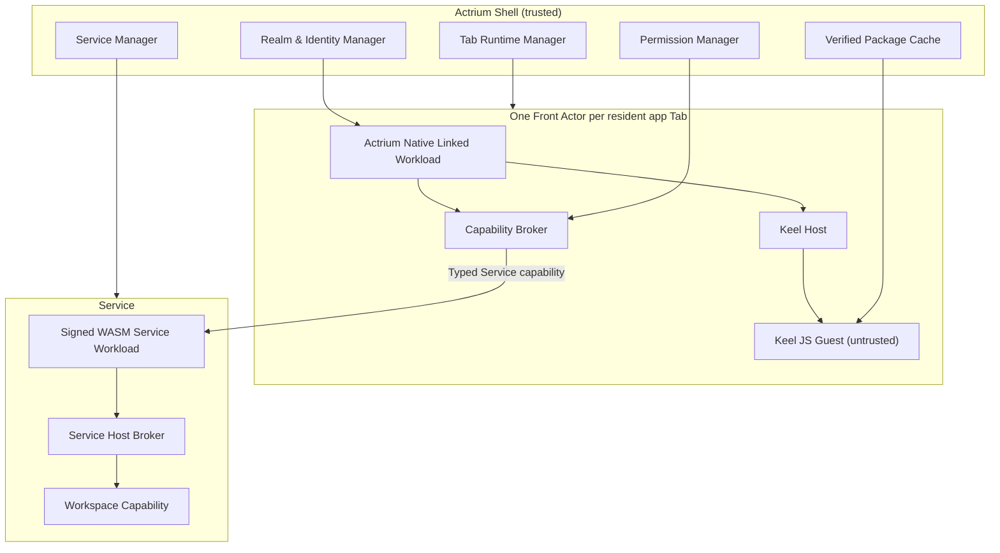

# 06. Runtime and the Front–Service protocol

## 1. Runtime overview



## 2. Front Actor

### 2.1 Fixed Native workload

Front uses an Actr linked/native workload:

- built, signed and published together with Actrium;
- not carried in the Publisher package;
- one logical Front Actor instance is created per resident app Tab;
- responsible for Actor registration, identity, connection, session, the Keel Engine and Host capabilities;
- an Actor credential can only prove the Actor key, ActorId, Actor type and issuer claims; it cannot by itself prove what code the other end is actually running (see [application development guidance](app-development-guidance.md) for how an application should respond to that).

Here, "Native workload" means the Actr Host is provided natively by the platform; it does not mean the Guest can supply native code.

### 2.2 Front Actor type

The Front's Actor type is an Actrium system type, for example:

```text
actrium/actrium-front@1.0.0
```

It describes the Host runtime and does not masquerade as a Program's Service ActrType. As part of the Attach handshake, the Actr Host additionally declares:

- the Program Release;
- the package digest;
- the Guest digest;
- the Front Host API;
- the Keel API;
- the protocol fingerprint;
- a local tab session nonce.

These fields are constructed by the Actrium Host from the verified package and cannot be overridden by the Guest; to the remote end they are client-declared values used for compatibility negotiation.

The platform provides optional remote attestation: a managed Realm can fold platform app attestation, distribution signatures, or enterprise device attestation into the credential, for a Service that needs it to verify.

### 2.3 Front lifecycle

```text
Allocated
  → ActorStarting
  → ServiceAttaching
  → ContractNegotiating
  → GuestLoading
  → Running
  ↔ Suspended
  → Detaching
  → Destroyed

Any stage → Failed
```

The following must hold:

- the Guest loads only after Attach and the contract succeed;
- capabilities are set up before the Guest executes;
- on close/crash, session capabilities are revoked first, then the Engine is destroyed;
- a background `pause` is not the same as a Service detach;
- a Front reclaimed from memory can be rebuilt from the Realm link and the Service state.

## 3. Keel v1 baseline

### 3.1 JS Guest only

For the v1 official Marketplace:

- `guest-runtime = "keel-js"`;
- the bundle is self-contained CommonJS;
- only React, the JSX runtime, the Keel Guest SDK, and `host:*` capabilities declared by Actrium are allowed;
- arbitrary npm/runtime `require` is prohibited;
- `eval`, non-literal dynamic `import`, and undeclared capabilities are prohibited;
- build analysis must `fail-on-violation`;
- static checks run again at install time; a Publisher's self-report cannot be trusted.

The Keel Native WASM Guest is not yet open, because its current public build, UI, events, pause/destroy, and terminable-execution capabilities do not yet meet the requirements for untrusted publishing.

### 3.2 Fixed QuickJS

v1 does not let Keel auto-select among JSC/Hermes/QuickJS:

- QuickJS Native is fixed;
- an interrupt-handler hard timeout must be implemented and enabled;
- the per-Guest heap limit must actually be passed into every QuickJS runtime;
- each Tab uses an independent runtime/context;
- each Guest runs on a dedicated execution thread/worker that the Actr Host can abort; the UI only receives render ops that have passed schema and quota checks;
- timers, callbacks, listeners and remote refs are cleaned up on destruction;
- a JS engine change counts as a security-baseline change and requires a version bump and tests.

Fixing QuickJS is meant to make the security semantics consistent across platforms; it does not mean QuickJS provides OS process isolation.

The above is a publishing bar, not an established capability of Actrium's currently bundled Keel copy. If the integrated version ignores the timeout, hardcodes the memory limit, cannot report heap usage, or can only execute the Guest on a non-abortable Shell/UI main thread, then official third-party Guests must not ship.

### 3.3 Isolation claims

v1 can promise:

- same-process language sandbox;
- capability isolation;
- heap/time/render-op quotas;
- Guest JS crash isolation;
- no default filesystem/socket/global native module.

v1 does not claim:

- browser-renderer-level process isolation;
- a kernel boundary;
- that QuickJS/C++ engine memory-safety bugs cannot affect the Actr Host;
- that a Guest hang can never affect same-process scheduling.

The long-term goal for high-risk Publishers is:

- a macOS XPC/helper process;
- a Windows AppContainer/helper process;
- an Android isolatedProcess;
- an independent extension/helper on iOS to the extent feasible, or a stronger WASM runtime;
- a worker the Actr Host can force-terminate.

## 4. Actrium Component Registry

Actrium cannot directly expose the whole of Keel's generic `DefaultComponents` to an untrusted Guest.

Every component must have:

- a name allowlist;
- a props schema;
- text, array, depth and render-op limits;
- a URI/asset policy;
- an event schema;
- a RemoteRef method allowlist;
- a platform-difference declaration;
- accessibility requirements.

Special rules:

- `Image` by default only accepts a package asset id;
- a remote `Image` goes through an explicit `host:net` capability and a domain allowlist;
- the Guest may not attach arbitrary HTTP headers;
- `WebView` is not in the default Actrium Component Registry;
- external links, Modal, StatusBar, file selection, and system sharing must go through an explicit capability;
- v1 disables the generic string RemoteRef by default and only opens typed methods.

## 5. Capability model

### 5.1 The front end's stable interface

In the near term, based on Keel's `KeelContractShape`:

- version;
- host modules;
- rpc;
- named events;
- input/output/event schema;
- a binary field marker;
- the capability manifest.

It is not WIT and must not be mislabeled as WIT in v1 documentation or the API.

To remain compatible with future JS/WASM Guests, the stable semantics use only:

```text
request/response RPC
fire-and-forget tell
named event
```

Cross-boundary function subscription, arbitrary callbacks, and a generic RemoteRef are not treated as a long-term public protocol.

### 5.2 Service capability

The only Actor entry point the Guest gets:

```typescript
interface Service {
  call<Route extends CallRoute>(
    route: Route,
    input: InputOf<Route>
  ): Promise<OutputOf<Route>>;

  tell<Route extends TellRoute>(
    route: Route,
    input: InputOf<Route>
  ): Promise<void>;

  on<Event extends EventName>(
    event: Event,
    handler: (payload: EventPayload<Event>) => void
  ): Unsubscribe;
}
```

Internally, the Actr Host fixes the target to the current Service's ActorId. The Guest cannot pass a target ActorId.

### 5.3 Other Front capabilities

Examples:

- `host:assets`
- `host:clipboard`
- `host:notifications`
- `host:camera`
- `host:microphone`
- `host:location`
- `host:external-link`
- `host:file-import`
- `host:file-export`
- `host:share`
- `host:net` (an exceptional capability, off by default)

Every call must go through:

1. the contract schema;
2. what the manifest requested;
3. the permission grant;
4. session scope;
5. platform policy;
6. rate/resource limits;
7. audit policy.

## 6. Service

### 6.1 The main facade

The Service:

- is the Front's only business entry point;
- validates the Attach session;
- holds the Workspace;
- turns Guest intents into business commands;
- is responsible for idempotency, authorization, audit and concurrency;
- can call or manage other Actors in the Realm.

Simplifying the front end does not constrain the back-end topology:

```text
Front
  → Service
      ├── Index Actor
      ├── Sync Actor
      ├── Media Actor
      └── Worker Actors
```

### 6.2 Service Host broker

A third-party Service workload cannot directly obtain all of the host's capabilities. The Broker provides:

- a declared subset of Actor call/tell/discover;
- the Workspace capability;
- an outbound HTTPS allowlist;
- clock/random/logging;
- a secret reference;
- a database namespace;
- resource limits;
- lifecycle snapshot/restore.

A Service workload's dependencies and network capabilities must be declared in the package manifest.

### 6.3 Same-Realm requirement

A Realm corresponds to one application instance, so the Front and the Service are naturally in the same Realm; the other Actors the Service orchestrates are also in that Realm:

- the Front obtains that instance's Realm membership before Attach (usually by joining through a Realm invitation);
- the connection ACL decides whether a Front type may connect to a Service type;
- type discovery happens only within this Realm (this instance's Actors); the Front also finds the Service by the package's Actor type;
- cross-instance (cross-Realm) calls are handled by the Service's back end: the Service's host obtains a client identity in the target Realm according to that Realm's join policy; the Front never federates directly, and v1 has no federation.

This significantly narrows the trust and error surface.

### 6.4 Two forms of Native workload

```text
NativeCdylib / InProcess
  → shares an address space with the Host
  → a third-party node must not be CONTROLLED

NativeCapsule / OutOfProcess
  → an independent restricted process per Actor
  → OS sandbox + brokered typed IPC
  → egress can be measured against policy once closed
```

A Native Capsule process must not hold the raw Actor transport, sockets, a Workspace path, or credentials; the Actr Host performs Actor calls, HTTP and Workspace operations on its behalf. The sandbox must take effect before any third-party instruction executes, and must forbid arbitrary dynamic libraries, subprocesses, ptrace, and shared writable memory. See [Privacy Marks and Aggregation Protocol](13-privacy-state-and-aggregation.md) for detailed platform conditions.

## 7. Front–Service system protocol

Besides the business proto, Actrium defines a stable system protocol:

```text
actrium.session.v1.Attach
actrium.session.v1.Resume
actrium.session.v1.Detach
actrium.session.v1.Heartbeat
actrium.session.v1.Takeover
actrium.session.v1.GetStatus
```

`ActorAssurance`, the unrooted graph, and `ApplicationAssurance` use the `actrium.privacy.v1.*` system protocol; see [13](13-privacy-state-and-aggregation.md). The semantics are governed by [docs/security](../../architecture/security/actrium/README.zh.md).

### 7.1 AttachRequest

```json
{
  "frontActorId": "<ActorId>",
  "serviceActorId": "<ActorId>",
  "program": {
    "publisher": "notes.example",
    "name": "team-notes",
    "version": "1.4.2",
    "packageDigest": "sha256:...",
    "guestDigest": "sha256:..."
  },
  "runtime": {
    "actriumVersion": "1.0.0",
    "frontHostApi": "1.0",
    "keelApi": "1.0"
  },
  "protocolFingerprint": "sha256:...",
  "tabSessionNonce": "<random>",
  "requestedLease": "exclusive",
  "challengeResponse": "<signed-proof>"
}
```

### 7.2 AttachResponse

```json
{
  "sessionId": "<opaque>",
  "lease": {
    "mode": "exclusive",
    "expiresAt": "2026-07-29T12:30:00Z",
    "heartbeatIntervalMs": 15000
  },
  "service": {
    "actorId": "<ActorId>",
    "program": "notes.example/team-notes@1.4.2",
    "packageDigest": "sha256:...",
    "protocolFingerprint": "sha256:..."
  },
  "workspace": {
    "displayName": "Team Notes",
    "mode": "read-write"
  },
  "effectiveCapabilities": ["service", "host:clipboard.write"],
  "privacy": {
    "actorStateDigest": "…",
    "applicationStateDigest": "…",
    "assuranceDigest": "sha256:...",
    "expiresAt": "2026-07-29T12:01:15Z"
  },
  "serviceChallenge": "<signed-proof>"
}
```

The Guest never touches the Actor credential, challenge key, or raw session secret.

## 8. Attach verification

The Service checks, in order:

1. the sender's Actor credential;
2. the caller ActorId against the credential claim;
3. the Front Actor type; if policy requires a trusted runtime, it also verifies a separate platform/runtime attestation;
4. the challenge/nonce, against replay;
5. the target Service ActorId;
6. the Program Release (a compatibility declaration);
7. the package digest (a compatibility declaration; without attestation it is not proof of the remote code);
8. the protocol fingerprint;
9. Application permissions: the member id, Realm client key id and role (owner/editor/viewer) in the Front credential, plus the Workspace scope;
10. the attachment policy;
11. the current lease;
12. the caller-required policy, the current `ActorStateDigest` / AA, and the nonce;
13. resource and rate limits.

Any identity or digest mismatch is a hard fail; it never falls into a "compatibility mode".

The Host API or protocol version may be negotiated within the range both sides declare; the negotiated result must be pinned to the session.

## 9. Session lease

v1's exclusive lease:

- a short-lived, renewable lease is created after Attach succeeds;
- a Heartbeat only renews the session, not the Actor identity;
- a session never outlives the Front credential: after renewing its credential, the Front presents the new one when renewing the lease and the Service reads the role again; otherwise the session ends when the old credential expires;
- a transient disconnect enters a grace period;
- `Detach` releases it actively;
- the lease expires after a Front crash;
- a Takeover requires permission and a conflict policy;
- the lease id/session secret are kept only in Actr Host memory and secure IPC, never given to the Guest;
- messages from the same expired session must be rejected.

## 10. Message routing

```text
Guest call
  → Keel contract validation
  → Front capability broker
  → attach session validation
  → fixed Dest::Peer(service_actor_id)
  → Actr RPC route
  → Service session guard
  → business handler
  → response schema validation
  → Guest
```

The Actr Host must attach metadata the Guest cannot override:

- the session id;
- a minimized principal/client id claim;
- the program digest;
- a trace id;
- a deadline;
- an idempotency key (where applicable).

## 11. Lifecycle protocol

### 11.1 Front background

- Keel `pause`;
- non-critical named events are paused;
- the session heartbeat is kept or slowed;
- the Service is not destroyed;
- it enters Detach when the OS reclaims it.

### 11.2 Front resume

- the Actor transport is restored;
- if the lease is still valid, `Resume`;
- otherwise, `Attach` again;
- Keel `resume`;
- a `lifecycle.foreground` named event is sent;
- the Guest re-fetches the state it needs.

### 11.3 Service restart

- it uses the same ActorId and long-term key;
- it restores the Workspace binding and the instance store;
- it accepts no business RPC before it has restored;
- the original session is invalidated by default, and the Front re-Attaches;
- the URI does not change.

## 12. Resource quotas

### 12.1 Front Guest

At minimum, limit:

- JS heap;
- wall time per execution;
- callbacks/timers per second;
- render batch ops;
- component-tree depth and node count;
- text, image and binary payloads;
- RPC concurrency, rate and deadline;
- log rate;
- local Guest storage.

### 12.2 Service workload

At minimum, limit:

- WASM memory/table;
- fuel/epoch timeout;
- mailbox length;
- RPC concurrency;
- data stream count and bandwidth;
- Workspace I/O;
- outbound network;
- actor discovery/call;
- snapshot size;
- logging.

Exceeding a limit must produce a stable error code, distinguishing a single call failure, a Guest termination, a Service degradation, and an instance stop.

## 13. Crash and isolation

Product goals:

- a Guest syntax/runtime error only terminates that Tab's Guest;
- a Guest timeout/heap overrun destroys that Keel Engine;
- a Front Actor failure does not change the Service ActorId;
- a Service workload failure does not corrupt other instances' stores;
- multiple Services of the same type use different instance data directories;
- one Tab's callbacks, timers, RemoteRefs and capabilities must not leak into another Tab;
- once the helper process ships, a Guest crash does not affect the Shell.

The v1 same-process implementation must validate these logical-isolation goals through fault injection, and must honestly label in the security UI that this is not equivalent to OS isolation.

## 14. Observability

Log by layer:

- URI parse/resolve;
- package verify;
- Front Actor lifecycle;
- Keel load/pause/resume/destroy;
- capability allow/deny;
- Attach/lease;
- Actr transport (local/P2P/TURN);
- Service lifecycle;
- Workspace I/O errors.

Default logs must not contain:

- Workspace content;
- credentials;
- session secrets;
- full file paths;
- Guest user input;
- the signaling authentication ticket.

An ActorId may be shown in its standard form for local diagnostics; before uploading telemetry, use an irreversible identifier salted per installation.

## 15. Forensics and graph assembly

The Front Host, Service Host, Workspace broker, and Actor transport must hand actual data-egress events to the forensic path:

- workload kind, digest, imports, and the runtime instance;
- Actor spawn/discover/call/stream/close;
- capability grant/revoke;
- the Workspace and external-network edge;
- package, credential, Actr Host key, and policy revocation.

A Publisher workload may declare its expected egress, but that cannot be the sole source of topology integrity. The Actr Host compares WASM's declarations, imports, effective capabilities and actual edges, and assembles the graph by `structureDigest` and the current `ActorStateDigest`; a new Actor must not receive application data until the current AA passes and it is `ACTIVE`. The Front locates the whole unrooted graph and takes the weakest link across nodes; display also requires `Ready`.

A change in the conclusion must propagate to the Shell and the session guard. Green/yellow/red and suspension must drive capabilities and the data plane; they cannot be mere UI decoration. A new configuration applies only to new data.
