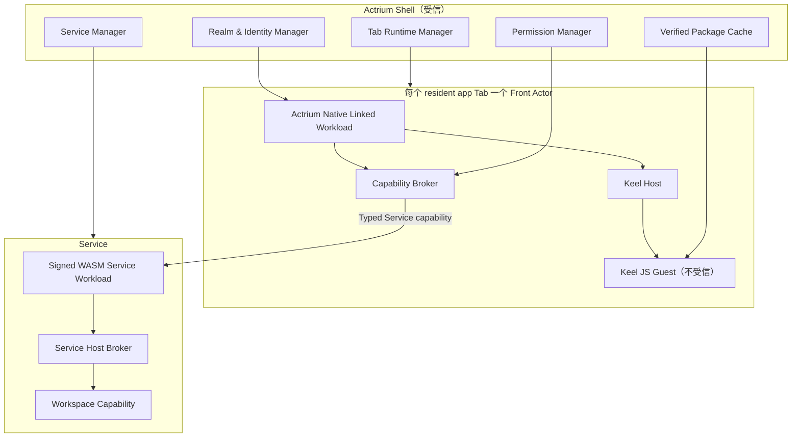

# 06. 运行时与 Front–Service 协议

## 1. 运行时总览



## 2. Front Actor

### 2.1 固定 Native workload

Front 使用 Actr linked/native workload：

- 与 Actrium 一起构建、签名和发布；
- Publisher package 中不携带；
- 每个 resident app Tab 创建一个逻辑 Front Actor 实例；
- 负责 Actor 注册、身份、连接、会话、Keel Engine 和 Host capability；
- Actor credential 只能证明 Actor key、ActorId、Actor 类型与 issuer claims，不能单独证明对端实际运行的代码（应用如何应对见[应用开发建议](app-development-guidance.zh.md)）。

「Native workload」在这里表示 Actr Host 由平台原生提供，不表示 Guest 可以提供 native code。

### 2.2 Front Actor 类型

Front 的 Actor 类型是 Actrium 系统类型，例如：

```text
actrium/actrium-front@1.0.0
```

它描述 Host runtime，不伪装成 Program 的 Service ActrType。Attach handshake 由 Actr Host 额外声明：

- Program Release；
- package digest；
- Guest digest；
- Front Host API；
- Keel API；
- protocol fingerprint；
- local tab session nonce。

这些字段由 Actrium Host 从已验证 package 构造，Guest 无法覆盖；对远端而言它们是客户端声明，用于兼容性协商。

平台提供可选的远端证明：受管 Realm 可以把平台 app attestation、发行签名或企业设备证明纳入 credential，供需要的 Service 验证。

### 2.3 Front 生命周期

```text
Allocated
  → ActorStarting
  → ServiceAttaching
  → ContractNegotiating
  → GuestLoading
  → Running
  ↔ Suspended
  → Detaching
  → Destroyed

任意阶段 → Failed
```

必须保证：

- Guest 只在 Attach 和 contract 成功后加载；
- capability 在 Guest 执行前完成；
- close/crash 先撤销 session capability，再销毁 Engine；
- background `pause` 不等于 Service detach；
- 内存回收后的 Front 可以从 Realm 链接和 Service 状态重建。

## 3. Keel v1 基线

### 3.1 只开放 JS Guest

v1 正式 Marketplace：

- `guest-runtime = "keel-js"`；
- bundle 是自包含 CommonJS；
- 仅允许 React、JSX runtime、Keel Guest SDK 和 Actrium 声明的 `host:*` capability；
- 禁止任意 npm/runtime require；
- 禁止 eval、非字面动态 import 和未声明 capability；
- 构建分析必须 `fail-on-violation`；
- 安装时再次静态检查，不能信任 Publisher 自报。

Keel Native WASM Guest 暂不开放，因为其当前公共构建、UI、事件、pause/destroy 和可终止执行能力尚未达到不受信发布要求。

### 3.2 固定 QuickJS

v1 不允许 Keel 自动选择 JSC/Hermes/QuickJS：

- 固定 QuickJS Native；
- 必须实现并启用 interrupt handler 硬超时；
- 必须把 per-Guest heap limit 真正传入每个 QuickJS runtime；
- 每个 Tab 使用独立 runtime/context；
- 每个 Guest 在 Actr Host 可中止的专用执行线程/worker 上运行，UI 只接收经过 schema 和配额检查的 render ops；
- 销毁时清理 timer、callback、listener 和 remote ref；
- JS 引擎变化视为安全基线变更，需要版本和测试。

固定 QuickJS 是为了让安全语义跨平台一致，不代表 QuickJS 是 OS 进程隔离。

以上是发布门槛，不是对 Actrium 当前内置 Keel 副本的既成能力。若所集成版本忽略 timeout、写死内存上限、无法报告 heap 使用量，或只能在不可中止的 Shell/UI 主线程执行 Guest，则正式第三方 Guest 不得上线。

### 3.3 隔离口径

v1 可承诺：

- same-process language sandbox；
- capability isolation；
- heap/time/render-op quota；
- Guest JS crash isolation；
- 不提供默认 filesystem/socket/global native module。

v1 不宣称：

- 浏览器 renderer 级独立进程；
- 内核边界；
- QuickJS/C++ 引擎内存安全漏洞无法影响 Actr Host；
- Guest 卡死永远不会影响同进程调度。

高风险 Publisher 的长期目标是：

- macOS XPC/helper process；
- Windows AppContainer/helper process；
- Android isolatedProcess；
- iOS 可行范围内的独立 extension/helper 或更强 WASM runtime；
- 可由 Actr Host 强制 terminate 的 worker。

## 4. Actrium Component Registry

Actrium 不能直接把通用 Keel `DefaultComponents` 全量暴露给不受信 Guest。

每个组件必须有：

- 名称白名单；
- props schema；
- 文本、数组、层级和 render-op 限制；
- URI/asset policy；
- event schema；
- RemoteRef 方法白名单；
- 平台差异声明；
- accessibility 要求。

特别规则：

- `Image` 默认只接受 package asset id；
- 远端 Image 走显式 `host:net` capability 和域名 allowlist；
- Guest 不得自带任意 HTTP headers；
- `WebView` 不进入默认 Actrium Component Registry；
- 外链、Modal、StatusBar、文件选择和系统分享必须通过显式 capability；
- v1 默认禁用通用字符串 RemoteRef，仅开放类型化方法。

## 5. Capability 模型

### 5.1 前台稳定接口

短期基于 Keel 的 `KeelContractShape`：

- version；
- host modules；
- rpc；
- named events；
- input/output/event schema；
- binary field marker；
- capability manifest。

它不是 WIT，不应在 v1 文档或 API 中误称 WIT。

为了兼容未来 JS/WASM Guest，稳定语义只采用：

```text
request/response RPC
fire-and-forget tell
named event
```

不把跨边界函数 subscription、任意 callback 或通用 RemoteRef 作为长期公共协议。

### 5.2 Service capability

Guest 获得的唯一 Actor 入口：

```typescript
interface Service {
  call<Route extends CallRoute>(
    route: Route,
    input: InputOf<Route>
  ): Promise<OutputOf<Route>>;

  tell<Route extends TellRoute>(
    route: Route,
    input: InputOf<Route>
  ): Promise<void>;

  on<Event extends EventName>(
    event: Event,
    handler: (payload: EventPayload<Event>) => void
  ): Unsubscribe;
}
```

Actr Host 在内部固定 target 为当前 Service ActorId。Guest 不可传 target ActorId。

### 5.3 其他 Front capability

示例：

- `host:assets`
- `host:clipboard`
- `host:notifications`
- `host:camera`
- `host:microphone`
- `host:location`
- `host:external-link`
- `host:file-import`
- `host:file-export`
- `host:share`
- `host:net`（例外能力，默认关闭）

每个调用必须经过：

1. Contract schema；
2. Manifest requested；
3. Permission grant；
4. session scope；
5. platform policy；
6. rate/resource limit；
7. audit policy。

## 6. Service

### 6.1 主 façade

Service：

- 是 Front 唯一业务入口；
- 验证 Attach session；
- 持有 Workspace；
- 将 Guest 意图转成业务命令；
- 负责幂等、授权、审计和并发；
- 可以调用或管理 Realm 内的其他 Actor。

前台简化不限制后台拓扑：

```text
Front
  → Service
      ├── Index Actor
      ├── Sync Actor
      ├── Media Actor
      └── Worker Actors
```

### 6.2 Service Host broker

第三方 Service workload 不能直接获得宿主全部能力。Broker 提供：

- Actor call/tell/discover 的声明子集；
- Workspace capability；
- outbound HTTPS allowlist；
- clock/random/logging；
- secret reference；
- database namespace；
- resource limits；
- lifecycle snapshot/restore。

Service workload 的依赖和网络能力必须在 package manifest 中声明。

### 6.3 同 Realm 要求

Realm 对应一个应用实例，因此 Front 与 Service 天然在同一 Realm；Service 编排的其他 Actor 也在该 Realm 内：

- Front 在 Attach 前取得该实例的 Realm membership（通常经 Realm 邀请加入）；
- 连接 ACL 决定 Front type 能否连接 Service type；
- 类型发现只在本 Realm（本实例的 Actor）内进行，Front 也按包的 Actor 类型找到 Service；
- 跨实例（跨 Realm）调用由 Service 后台处理：Service 的宿主按目标 Realm 的加入策略在该 Realm 取得客户端身份；Front 不直接联邦，v1 没有 federation。

这显著缩小信任和错误面。

### 6.4 Native workload 两种形态

```text
NativeCdylib / InProcess
  → 与 Host 同地址空间
  → 第三方节点不得为 CONTROLLED

NativeCapsule / OutOfProcess
  → 每 Actor 独立受限进程
  → OS sandbox + brokered typed IPC
  → 出口闭合时可按 policy 度量
```

Native Capsule 进程不得拥有原始 Actor transport、socket、Workspace path 或 credential；Actr Host 代表它完成 Actor call、HTTP 和 Workspace 操作。Sandbox 必须在第三方指令执行前生效，并禁止任意动态库、子进程、ptrace 和共享可写内存。详细平台条件见[隐私标记与汇聚协议](13-privacy-state-and-aggregation.md)。

## 7. Front–Service 系统协议

业务 proto 之外，Actrium 定义稳定系统协议：

```text
actrium.session.v1.Attach
actrium.session.v1.Resume
actrium.session.v1.Detach
actrium.session.v1.Heartbeat
actrium.session.v1.Takeover
actrium.session.v1.GetStatus
```

`ActorAssurance`、无根图和 `ApplicationAssurance` 使用 `actrium.privacy.v1.*` 系统协议，见 [13](13-privacy-state-and-aggregation.md)。语义以 [docs/security](../../architecture/security/actrium/README.zh.md) 为准。

### 7.1 AttachRequest

```json
{
  "frontActorId": "<ActorId>",
  "serviceActorId": "<ActorId>",
  "program": {
    "publisher": "notes.example",
    "name": "team-notes",
    "version": "1.4.2",
    "packageDigest": "sha256:...",
    "guestDigest": "sha256:..."
  },
  "runtime": {
    "actriumVersion": "1.0.0",
    "frontHostApi": "1.0",
    "keelApi": "1.0"
  },
  "protocolFingerprint": "sha256:...",
  "tabSessionNonce": "<random>",
  "requestedLease": "exclusive",
  "challengeResponse": "<signed-proof>"
}
```

### 7.2 AttachResponse

```json
{
  "sessionId": "<opaque>",
  "lease": {
    "mode": "exclusive",
    "expiresAt": "2026-07-29T12:30:00Z",
    "heartbeatIntervalMs": 15000
  },
  "service": {
    "actorId": "<ActorId>",
    "program": "notes.example/team-notes@1.4.2",
    "packageDigest": "sha256:...",
    "protocolFingerprint": "sha256:..."
  },
  "workspace": {
    "displayName": "Team Notes",
    "mode": "read-write"
  },
  "effectiveCapabilities": ["service", "host:clipboard.write"],
  "privacy": {
    "actorStateDigest": "…",
    "applicationStateDigest": "…",
    "assuranceDigest": "sha256:...",
    "expiresAt": "2026-07-29T12:01:15Z"
  },
  "serviceChallenge": "<signed-proof>"
}
```

Guest 不接触 Actor credential、challenge key 或原始 session secret。

## 8. Attach 校验

Service 按顺序检查：

1. 发送方 Actor credential；
2. caller ActorId 与 credential claim；
3. Front Actor type；若 policy 要求可信 runtime，再验证独立的 platform/runtime attestation；
4. challenge/nonce 防重放；
5. target Service ActorId；
6. Program Release（兼容性声明）；
7. package digest（兼容性声明；无 attestation 时不是远端代码证明）；
8. protocol fingerprint；
9. 应用权限：Front credential 中的成员 id、Realm 客户端 key id 与角色（owner/editor/viewer），以及 Workspace 范围；
10. attachment policy；
11. 当前 lease；
12. 调用方要求的策略、当前 `ActorStateDigest` / AA 与 nonce；
13. 资源和速率限制。

任何身份或 digest mismatch 都是 hard fail，不进入「兼容模式」。

Host API 或协议版本可以在双方声明的范围内协商；协商结果必须固定到 session。

## 9. Session lease

v1 exclusive lease：

- Attach 成功后创建短期可续约 lease；
- Heartbeat 只续会话，不续 Actor 身份；
- 会话不超过 Front credential 的有效期：Front 续期 credential 后在 lease 续约时出示新 credential，Service 据此重读角色，否则在旧 credential 到期时结束会话；
- 瞬时断线进入 grace period；
- `Detach` 主动释放；
- Front crash 后 lease 到期；
- Takeover 需要权限与冲突策略；
- lease id/session secret 只保存在 Actr Host 内存和安全 IPC，不给 Guest；
- 同一个过期 session 的消息必须拒绝。

## 10. 消息路由

```text
Guest call
  → Keel contract validation
  → Front capability broker
  → attach session validation
  → fixed Dest::Peer(service_actor_id)
  → Actr RPC route
  → Service session guard
  → business handler
  → response schema validation
  → Guest
```

Actr Host 必须附加不可由 Guest覆盖的 metadata：

- session id；
- principal/client id 的最小化 claim；
- program digest；
- trace id；
- deadline；
- idempotency key（适用时）。


## 11. 生命周期协议

### 11.1 Front background

- Keel `pause`；
- 暂停非关键 named events；
- 保持或降低 session heartbeat；
- 不销毁 Service；
- OS 回收时进入 Detach。

### 11.2 Front resume

- 恢复 Actor transport；
- 如 lease 仍有效，`Resume`；
- 否则重新 `Attach`；
- Keel `resume`；
- 发送 `lifecycle.foreground` named event；
- Guest 重新拉取必要状态。

### 11.3 Service restart

- 使用同一 ActorId 和长期 key；
- 恢复 Workspace binding 与实例 store；
- 恢复前不接受业务 RPC；
- 原 session 默认失效，Front 重新 Attach；
- 不改变 URI。

## 12. 资源配额

### 12.1 Front Guest

至少限制：

- JS heap；
- 单次执行 wall time；
- 每秒 callback/timer；
- render batch op；
- 组件树深度和节点数；
- 文本、图片和二进制 payload；
- RPC 并发、速率和 deadline；
- 日志速率；
- 本地 Guest storage。

### 12.2 Service workload

至少限制：

- WASM memory/table；
- fuel/epoch timeout；
- mailbox 长度；
- RPC 并发；
- data stream 数量和带宽；
- Workspace I/O；
- outbound network；
- actor discovery/call；
- snapshot 大小；
- 日志。

超限要有稳定错误码，并区分单次调用失败、Guest 终止、Service 降级和实例停止。

## 13. Crash 与隔离

产品目标：

- Guest 语法/运行错误只终止该 Tab Guest；
- Guest timeout/heap 超限销毁该 Keel Engine；
- Front Actor 失败不改变 Service ActorId；
- Service workload 失败不损坏其他实例 store；
- 同类型多个 Service 使用不同 instance data directory；
- 一个 Tab 的 callback、timer、RemoteRef 和 capability 不能泄漏到另一个 Tab；
- helper process 上线后，Guest crash 不影响 Shell。

v1 same-process 实现必须通过故障注入验证这些逻辑隔离目标，并在安全 UI 中诚实标注其不等同 OS 隔离。

## 14. 可观测性

按层记录：

- URI parse/resolve；
- package verify；
- Front Actor lifecycle；
- Keel load/pause/resume/destroy；
- capability allow/deny；
- Attach/lease；
- Actr transport（local/P2P/TURN）；
- Service lifecycle；
- Workspace I/O 错误。

默认日志不得包含：

- Workspace 内容；
- credential；
- session secret；
- 完整文件路径；
- Guest 用户输入；
- 信令认证票据。

ActorId 在本地诊断可显示标准形式；上传遥测前使用不可逆、按安装加盐的标识。

## 15. 取证与组图

Front Host、Service Host、Workspace broker 和 Actor transport 必须把实际数据出口事件交给取证路径：

- workload kind、digest、imports 与 runtime instance；
- Actor spawn/discover/call/stream/close；
- capability grant/revoke；
- Workspace 与外部网络 edge；
- package、credential、Actr Host key 和 policy 撤销。

Publisher workload 可以声明预期出口，但不能成为拓扑完整性的唯一来源。Actr Host 对 WASM 比较声明、imports、有效能力与实际边，按 `structureDigest` 与当前 `ActorStateDigest` 组图；新 Actor 在当前 AA 通过且 `ACTIVE` 前不得收到应用数据。Front 定位整张无根图，取各节点最弱项；展示还须 `Ready`。

结论变化必须传到 Shell 和 session guard。绿 / 黄 / 红与挂起必须联动 capability 和数据面，不能只是 UI 装饰。新配置只作用于新数据。
