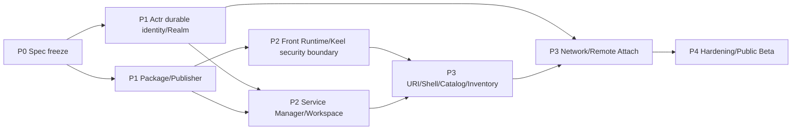

# 11. Delivery plan and feasibility

## 1. Feasibility conclusions

Overall this is **feasible, but it is not just a change to the Actrium UI**.

The existing technology base already covers most of the "mechanisms":

- Actr has precise `ActorId` addressing;
- Actr has discovery by `ActrType`;
- Actr has Realm, connection ACL, signaling, WebRTC, and TURN;
- Actr has Linked, NativeCdylib, and WASM workloads;
- Actr's `.actr` already has signing, hashes, resources, and a dependency lock;
- Keel already has Host/Guest, Bridge, contracts, a JS sandbox, and a native component tree;
- Actrium already has a cross-platform Shell, Tab, a shared runtime, and a local persistence foundation.

What is really missing are product-level invariants and several key semantics:

1. Service ActorId's durable identity;
2. the formal trust chain between the Publisher domain and the package key;
3. Realm domains and signing keys, per-instance Realm Profiles, and Realm Infra Provider delegation;
4. separation of Program/Service/Workspace;
5. a fixed Front Native Host and a controlled Keel Guest;
6. the create-instance transaction and the Realm-link open flow;
7. the Front–Service Attach/session protocol;
8. the security components and the capability broker;
9. per-instance storage;
10. an honest lifecycle on mobile.

## 2. Key dependency graph

The durable ActorId is the longest critical path. Without it, opening an instance, history, favorites, restart recovery, and Service Inventory all fail to hold.

## 3. P0: Spec freeze

### Goal

Turn this document's product semantics into a cross-repository, testable contract.

### Deliverables

- test vectors for the `actr://` Realm link;
- Publisher Profile schema;
- Actrium manifest extension schema;
- the Realm signing key (the authority descriptor's `realm_signing_keys` member and the core `realms` relation, already defined in Actr Authority Discovery §4.3–4.4) and the Realm Profile schema;
- persistent Actor identity lifecycle ADR;
- Front–Service session proto;
- ActorAssurance / ApplicationAssurance / EncGraph schema;
- privacy data-class, policy, and the weakest-item aggregation rule;
- capability/permission taxonomy;
- Service/Workspace state machine;
- a stable error code registry;
- threat model.

### Exit criteria

- Actrium, Actr, and Keel maintainers sign off on the core invariants;
- schemas have a version field;
- golden tests for create/attach/identity mismatch are frozen;
- there is no open question of "implement first, decide whether the ActorId is stable later".

## 4. P1-A: Actr durable identity and Realm

### Actr must change

1. the Actor long-term key model;
2. the ActorId text and wire model change to `<serial>.<realm_id>@<domain>`: a verifiable Realm name replaces the numeric realm_id, and the Actor type moves into registration and the credential (done);
3. two registration paths: create and reclaim ActorId;
4. persistence of the ActorId and renewal/identity state;
5. hard re-auth keeps the same ActorId;
6. the Actor serial is never reused within a Realm;
7. separating the current endpoint/presence from the logical ActorId;
8. the Realm signing key, the Realm Profile it signs, and Realm issuer key discovery;
9. the Actor credential binds a public key, and holding the private key is proven with a transcript/SDP challenge;
10. a one-time signaling ticket/header;
11. Realm Infra Provider delegation and failover; one Realm Infra Provider hosts multiple Realms, and Realm creation is authorized by a Realm signing key signature;
12. per-Realm/TURN-pool key id and rotation;
13. Publisher DNS length and normalization;
14. the Actor store namespace accepts instance identity;
15. the verifier's identity and signed `ActorAssurance`;
16. observation of Actor spawn/call/stream/egress edges;
17. a system protocol for `ActorStateDigest` / `ApplicationStateDigest` subscription and revocation propagation.

### Must be kept

- `Dest::Peer(ActrId)` exact addressing;
- `ActrType + fingerprint` discovery;
- the Realm's default-deny connection ACL;
- workload lifecycle hooks;
- `.actr` verification;
- WebRTC state/fast path.

### Exit criteria

- the same Service's ID stays unchanged across process restart, credential renewal, hard re-auth, and signaling failover;
- a Realm can replace its signaling endpoint within the same Realm Infra Provider while the Realm name and ActorId stay unchanged;
- ActorId reclaim has key proof and conflict protection;
- the legacy ephemeral identity path is never used by an Actrium Service;
- the Actr Host can generate verifiable evidence for actual workloads and Actor edges; a malicious Actor cannot hide a controlled call edge.

## 5. P1-B: Publisher and package

### Deliverables

- Publisher Profile resolver;
- domain/IDNA normalizer;
- key history/rotation store;
- package digest pinning;
- Actrium manifest extension;
- Guest/contract/assets folded into the `.actr` resource hash;
- content-addressed cache;
- zip safety policy;
- Marketplace metadata adapter;
- dev source adapter.

### Actr package changes

- the publisher field accepts a normalized Publisher domain;
- the manifest gains a backward-compatible `[actrium]` section;
- the verifier outputs typed Actrium metadata;
- the binary only allows a supported kind;
- the resource hash, lock, and proto are kept;
- the package signing key id ties into the Publisher Profile.

### Exit criteria

- a `.actr` can be downloaded and verified per the Realm Profile's `package`;
- a mismatched package for the same version is reliably detected;
- an offline cache can be re-verified;
- the Front Host cannot be replaced from within a package.

## 6. P2-A: Front Runtime and Keel

### Actrium

- a per-Tab Front Actor manager;
- fixed linked/native workload;
- verified Guest byte loader;
- explicit Keel Engine create/pause/resume/destroy;
- capability broker;
- session guard;
- resource accounting;
- the Front Privacy Evaluator and aggregate subscription;
- a crash page and diagnostics.

### Keel

- support for the Actr Host loading from verified bytes;
- fixed QuickJS provider config;
- implement and verify a real Native QuickJS `JS_SetInterruptHandler`/deadline;
- pass the per-Guest heap limit into the runtime, and implement trustworthy heap diagnostics;
- strict bundle analysis;
- eval/dynamic import violation;
- capability manifest;
- callback/timer/destroy tests;
- a Safe Component schema extension point;
- forbid implicit network components by default.

### Actrium Safe Components

- a minimal set of View/Text/Scroll/Input/Button/List/Image, etc.;
- props/event schema;
- asset-only Image by default;
- type-safe RemoteRef;
- render op quota;
- accessibility.

### Exit criteria

- a malicious Guest cannot obtain fetch/fs/arbitrary actor;
- under real Native QuickJS, an infinite loop, heap overrun, or render bomb is isolated to a single Tab;
- 10,000 close/rebuild cycles produce no callback/capability leak across Tabs;
- security copy accurately labels this a same-process sandbox;
- the Front can locate the rootless graph per policy and aggregate a conclusion; it never shows green while any node is unknown or the cut is not Ready.

## 7. P2-B: Service Manager and Workspace

### Deliverables

- durable creation intent;
- Service Inventory store;
- stable identity bootstrap;
- per-instance directory;
- WASM Service runtime policy;
- Workspace broker;
- exclusive writer lease;
- stop/start/archive/trash/restore/purge;
- snapshot/restore;
- the local pseudo-domain `<installation-id>.actr.alt` and one local Realm per instance;
- platform runtime adapters;
- Service subtree privacy aggregate;
- Actor/terminal egress evidence.

### Exit criteria

- multiple Services of the same type are fully isolated;
- restart keeps the same ActorId;
- Trash can restore with the same ActorId; purging never deletes the Workspace;
- a crash at any stage of creation does not duplicate it;
- the suspended state on mobile platforms is explainable;
- revoking a required Actor within the Realm propagates to the Front aggregate and blocks the related data path.

## 8. P3-A: Shell, URI, and management surfaces

### Deliverables

- address bar parser/formatter;
- Create/Attach confirmation;
- replace the URI after creation;
- Program Catalog;
- Service Inventory;
- program-template favorites/instance favorites;
- history and session restore;
- the security information panel;
- the address bar's green/yellow/red plus weakest-item/egress detail;
- the permission center;
- error pages;
- the external scheme handler;
- developer mode.

### Exit criteria

- Create and Attach behavior has no implicit branches;
- every failure has a stable error and a recovery action;
- a duplicate local Service focuses the existing one;
- Refresh/Back/Crash never duplicate creation;
- the address bar shows green only when `Ready` and the conclusion is green, and it can locate the weakest item.

## 9. P3-B: Networked Realms and remote Attach

### Deliverables

- domain trust and creating a networked Realm per instance;
- joining an instance's Realm via a Realm invitation and obtaining Realm membership;
- signaling Realm Infra Provider failover;
- P2P/TURN;
- resolving the Realm name from the Realm link and obtaining the Realm Profile;
- Actor/peer handshake;
- Attach challenge;
- exclusive lease/takeover;
- offline/suspended/denied states;
- metadata privacy UI.

### Exit criteria

- opening the same URI across devices lands precisely on the same Service;
- knowing the ActorId alone, without permission, cannot establish a connection;
- signaling cannot impersonate an Actor;
- TURN uses a short-lived credential;
- Realm Infra Provider failover never changes the ActorId.

## 10. P4: Hardening and public beta

### Security

- parser/bridge/package fuzz;
- third-party penetration testing;
- SBOM/provenance;
- emergency revoke;
- key compromise dkeel;
- Workspace deletion/recovery dkeel;
- signaling/TURN metadata review;
- security graph spoofing, omission, cycle, over-limit, and stale evidence review.

### Stability

- fault injection;
- power loss/disk full;
- network switchover;
- suspend/kill on mobile;
- package cache corruption;
- Realm signing key and Realm issuer key rotation;
- large-scale Tab/Service counts;
- long-lived leases;
- migration/rollback;
- revocation propagation across multiple Actr Hosts, rejection of mixed snapshots, and isolation of optional dependencies.

### Product

- accessibility;
- internationalization;
- support/diagnostic export;
- privacy policy;
- the Marketplace review process;
- enterprise policy.

## 11. Migration boundary for the current repository

This PRD does not require preserving the existing Actr/AppSession/URL behavior, but recommends reusing mature mechanisms:

| Current area | Target |
|---|---|
| `packages/actrium` | Split out the Tab Runtime Manager, Front Host, and system UI |
| `packages/keel` | Serve as an upstream dependency/sync package; add strict Guest security capabilities |
| `packages/actrium-browser-model` | Land the shared Program/Service/Tab/Realm model |
| `packages/actrium-runtime-host` | Land the Front Runtime and the capability broker |
| `packages/actrium-app-sdk` | Land the public API aimed only at Keel Guest |
| `crates/actrium-core` | URI, normalization, the package/realm model, durable-state rules |
| `contracts/` | URI, manifest, session, service, workspace contracts |
| platform apps | Shell, OS lifecycle, secure storage, helper process |

The historical `.actr` URL, remote app API, and multi-Tab legacy runtime:

- may get a one-time import/migration tool;
- do not enter the new public model;
- the dual-track API is not extended further;
- the UI clearly marks legacy items during migration;
- and are ultimately replaced by Program Release + Service.

## 12. Risk list

| Risk | Severity | Mitigation |
|---|---|---|
| ActorId cannot be made stable | Blocking | Fix identity first in P1; do not ship cross-device open |
| iOS local background is not sustainable | High | Commit explicitly to foreground; use a remote host; suspended state |
| Keel same-process sandbox escape | High | Fixed QuickJS, minimal TCB, fuzzing; plan a helper process |
| Publisher domain transfer | High | Key history, digest pin, identity-change prompt |
| Service WASM capability is insufficient | High | Build the capability broker and ABI as a minimal closed loop first |
| Workspace corruption from multiple writers | High | v1 exclusive writer |
| Create instance is abused | Medium | Confirmation, idempotency, rate limiting, quotas |
| Realm Infra Provider is over-centralized | Medium | Realm Profile delegation, multiple Realm Infra Providers, self-hosting |
| Package format extension forks | Medium | Extend `.actr` directly; do not nest a second package layer |
| Host behavior drifts across platforms | Medium | Shared schema/golden tests, fixed sandbox |
| Version/Actor type upgrades are complex | Medium | v1 uses explicit new-Actor migration |
| Marketplace is mistaken for a trust root | Medium | UI and protocol separate identity from review |
| Actor self-reports leak or conceal downstream effects | High | The Actr Host closes the effective declaration and discovers inbound edges; a self-report is only a declaration; self-signed final conclusions are forbidden |
| Dynamic changes to the privacy graph cause a brief false green | High | Suspend on change, never show green before Ready, generation gating blocks stale data |
| Large graphs/cycles cause DoS | Medium | Dedupe undirected connected components, cap nodes/edges, incremental weakest-item aggregation; never green over the limit |
| Native Capsule platform semantics drift | High | Fix a conformance profile; missing constraints fail closed or stay unknown |

## 13. Matters left to implementation decisions that do not block the product model

The following can be decided in a P0/P1 ADR without changing this document's core semantics:

- the final binary/text encoding of ActorId authority;
- the Marketplace/enterprise enforcement tier of the Publisher offline root;
- the specific WIT version used by the Service WASM Host API;
- how the Front–Service business contract generates the Keel TS schema from Proto;
- the platform implementation order for the helper process;
- the auto-generation format for a local Realm's RealmId;
- the specific encoding and version negotiation for the snapshot envelope;
- the Marketplace transparency-log provider;
- the policy format for an enterprise private CA;
- the remote attestation format for `ActorAssurance` and the platform attestation provider;
- the specific encoding and caching strategy for the privacy evidence root;
- the minimum conformance profile for Native Capsule on Windows/Linux/macOS/Android.

The following are no longer open questions:

- whether to connect by exact ActorId: yes;
- whether to load-balance a stateful Service: no;
- whether the Workspace is bound by the Service: yes;
- whether Publisher uses a domain name: yes;
- whether a Front Publisher can write to the Actr Host: no;
- whether a link triggers creation: no, creating an instance is a local Actrium operation;
- whether a failed instance open creates a substitute: no;
- whether Marketplace is a naming authority: no;
- whether signaling is "powerless": no;
- whether a Realm is bound one-to-one to a physical signaling server: no;
- whether a Realm corresponds to an application instance: yes, creating an instance always creates a new Realm;
- whether one Realm Infra Provider hosts multiple Realms: yes.

## 14. Minimum vertical slice

The first demonstrable vertical slice does only:

1. macOS;
2. a local Realm;
3. one signed `.actr` WASM Service;
4. one Keel JS Guest inside the package;
5. managed Workspace;
6. creating an instance from a local package;
7. the address bar shows the Realm link;
8. the same ActorId recovers after close/restart;
9. fixed QuickJS;
10. only the Service RPC is exposed.

Once this slice holds, later platforms and networking extend a stable model instead of continuing to probe object relationships.
</content>
