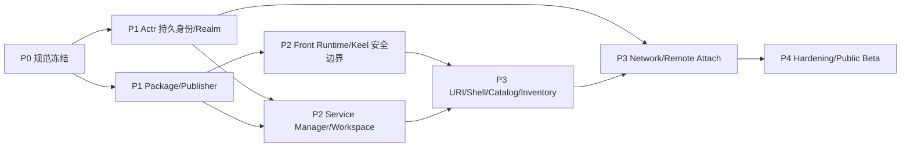

# 11. 交付计划与可行性

## 1. 可行性结论

总体为 **可行，但不是只改 Actrium UI**。

现有技术积累已经覆盖大部分「机制」：

- Actr 有精确 `ActorId` 寻址；
- Actr 有按 `ActrType` 发现；
- Actr 有 Realm、连接 ACL、signaling、WebRTC、TURN；
- Actr 有 Linked、NativeCdylib 和 WASM workload；
- Actr `.actr` 已有签名、hash、资源和依赖锁；
- Keel 已有 Host/Guest、Bridge、契约、JS sandbox 和原生组件树；
- Actrium 已有跨平台 Shell、Tab、共享运行时和本地持久化基础。

真正缺少的是产品级不变量与若干关键语义：

1. Service ActorId 的持久身份；
2. Publisher domain 与 package key 的正式信任链；
3. Realm 域名与签名 key、按实例创建的 Realm Profile 与 Realm Infra Provider 委派；
4. Program/Service/Workspace 分离；
5. 固定 Front Native Host 和受控 Keel Guest；
6. 新建实例事务与 Realm 链接打开流程；
7. Front–Service Attach/session 协议；
8. 安全组件与 capability broker；
9. per-instance storage；
10. 移动端诚实的生命周期。

## 2. 关键依赖图

持久 ActorId 是最长关键路径。它不成立时，打开实例、历史、收藏、重启恢复和 Service Inventory 都无法兑现。

## 3. P0：规范冻结

### 目标

把本文中的产品语义变成跨仓库可测试 contract。

### 交付物

- `actr://` Realm 链接的测试向量；
- Publisher Profile schema；
- Actrium manifest extension schema；
- Realm 签名 key（authority descriptor 的 `realm_signing_keys` 成员与 core relation `realms`，已在 Actr Authority Discovery §4.3–4.4 定义）与 Realm Profile schema；
- persistent Actor identity lifecycle ADR；
- Front–Service session proto；
- ActorAssurance / ApplicationAssurance / EncGraph schema；
- privacy data-class、policy 与最弱项汇聚规则；
- capability/permission taxonomy；
- Service/Workspace state machine；
- 稳定 error code registry；
- threat model。

### 退出条件

- Actrium、Actr、Keel 维护者对核心不变量签字；
- schema 有版本字段；
- create/attach/identity mismatch 的 golden tests 冻结；
- 无「先实现再决定 ActorId 是否稳定」的悬空问题。

## 4. P1-A：Actr 持久身份与 Realm

### Actr 必改

1. Actor长期 key 模型；
2. ActorId 文本和 wire model 改为 `<serial>.<realm_id>@<domain>`：以可验证的 Realm 名取代数值 realm_id，并把 Actor 类型移到注册与 credential（已完成）；
3. 新建与 reclaim ActorId 两条注册路径；
4. ActorId、renewal/identity state 持久化；
5. hard re-auth 保持同一 ActorId；
6. Realm 内 Actor serial 永不复用；
7. current endpoint/presence 与 logical ActorId 分离；
8. Realm 签名 key、由其签名的 Realm Profile 和 Realm issuer key discovery；
9. Actor credential 绑定 public key，并以 transcript/SDP challenge 证明私钥持有；
10. signaling 一次性 ticket/header；
11. Realm Infra Provider 委派与 failover；一个 Realm Infra Provider 承载多个 Realm，Realm 创建经 Realm 签名 key 签名授权；
12. per-Realm/TURN-pool key id 与轮换；
13. Publisher DNS 长度和规范化；
14. Actor store namespace 接受 instance identity；
15. 验证者身份与签名 `ActorAssurance`；
16. Actor spawn/call/stream/egress edge 观测；
17. `ActorStateDigest` / `ApplicationStateDigest` 订阅和撤销传播系统协议。

### 必须保留

- `Dest::Peer(ActrId)` 精确寻址；
- `ActrType + fingerprint` 发现；
- Realm default-deny 连接 ACL；
- workload lifecycle hooks；
- `.actr` verification；
- WebRTC state/fast path。

### 退出条件

- 同一 Service 在进程重启、credential 续期、hard re-auth、signaling failover 后 ID 不变；
- Realm 可以在同一 Realm Infra Provider 内替换 signaling endpoint，Realm 名与 ActorId 不变；
- ActorId reclaim 有 key proof 和冲突保护；
- legacy ephemeral identity 路径不会被 Actrium Service 使用；
- Actr Host 能为实际 workload 和 Actor edge 生成可验证 evidence，恶意 Actor 不能隐藏受控调用边。

## 5. P1-B：Publisher 与 package

### 交付物

- Publisher Profile resolver；
- domain/IDNA normalizer；
- key history/rotation store；
- package digest pinning；
- Actrium manifest extension；
- Guest/contract/assets 纳入 `.actr` resource hash；
- content-addressed cache；
- zip safety policy；
- Marketplace metadata adapter；
- dev source adapter。

### Actr package 改动

- publisher 字段允许规范化 Publisher 域名；
- manifest 增加向后兼容的 `[actrium]` section；
- verifier 输出 typed Actrium metadata；
- binary 只允许支持 kind；
- resource hash、lock 和 proto 保持；
- package signing key id 对接 Publisher Profile。

### 退出条件

- 按 Realm Profile 的 `package` 可下载并验证一个 `.actr`；
- 同版本异包被稳定检测；
- 离线缓存可重新验证；
- package 中无法替换 Front Host。

## 6. P2-A：Front Runtime 与 Keel

### Actrium

- 每 Tab Front Actor manager；
- fixed linked/native workload；
- verified Guest byte loader；
- Keel Engine 明确 create/pause/resume/destroy；
- capability broker；
- session guard；
- resource accounting；
- Front Privacy Evaluator 与 aggregate subscription；
- crash page 与诊断。

### Keel

- 支持 Actr Host 从已验证 bytes 加载；
- fixed QuickJS provider config；
- 实现并验证真实 Native QuickJS `JS_SetInterruptHandler`/deadline；
- 把 per-Guest heap limit 传入 runtime，并实现可信 heap 诊断；
- strict bundle analysis；
- eval/dynamic import violation；
- capability manifest；
- callback/timer/destroy 测试；
- Safe Component schema 扩展点；
- 禁止默认隐式网络组件。

### ActriumSafeComponents

- View/Text/Scroll/Input/Button/List/Image 等最小集；
- props/event schema；
- asset-only Image 默认；
- type-safe RemoteRef；
- render op quota；
- accessibility。

### 退出条件

- 恶意 Guest 无法获得 fetch/fs/arbitrary actor；
- 真实 Native QuickJS 下无限循环、heap 超限、render bomb 被单 Tab隔离；
- 关闭/重建 10,000 次无 callback/capability 跨 Tab 泄漏；
- 安全文案准确标为 same-process sandbox；
- Front 能按策略定位无根图并汇聚结论，任一节点未知或切面未就绪时不会显示绿。

## 7. P2-B：Service Manager 与 Workspace

### 交付物

- durable creation intent；
- Service Inventory store；
- stable identity bootstrap；
- per-instance directory；
- WASM Service runtime policy；
- Workspace broker；
- exclusive writer lease；
- stop/start/archive/trash/restore/purge；
- snapshot/restore；
- 本机伪域名 `<installation-id>.actr.alt` 与每实例本机 Realm；
- platform runtime adapters；
- Service subtree privacy aggregate；
- Actor/terminal egress evidence。

### 退出条件

- 同类型多个 Service 完全隔离；
- 重启同 ActorId；
- 回收站可用同一 ActorId 恢复，彻底清除不删 Workspace；
- 创建任意阶段 crash 不重复；
- 移动平台 suspended 状态可解释；
- Realm 内必要 Actor 的撤销能传播到 Front aggregate 并阻止相关数据路径。

## 8. P3-A：Shell、URI 与管理面

### 交付物

- address bar parser/formatter；
- Create/Attach confirmation；
- 创建后 replace URI；
- Program Catalog；
- Service Inventory；
- 模板收藏/实例收藏；
- 历史与 session restore；
- 安全信息面板；
- 地址栏绿 / 黄 / 红与最弱项 / 出口详情；
- 权限中心；
- 错误页；
- 外部 scheme handler；
- developer mode。

### 退出条件

- Create 与 Attach 行为没有隐式分支；
- 所有失败均有稳定错误和恢复动作；
- 本机重复 Service 聚焦；
- Refresh/Back/Crash 不重复创建；
- 地址栏只有 `Ready` 且结论为绿才显示绿色，并能定位最弱项。

## 9. P3-B：联网 Realm 与远端 Attach

### 交付物

- 域名信任与按实例创建联网 Realm；
- 经 Realm 邀请加入实例 Realm 并取得 Realm membership；
- signaling Realm Infra Provider failover；
- P2P/TURN；
- 从 Realm 链接解析 Realm 名并取得 Realm Profile；
- Actor/peer handshake；
- Attach challenge；
- exclusive lease/takeover；
- offline/suspended/denied 状态；
- 元数据隐私 UI。

### 退出条件

- 跨设备打开同一 URI 精确到同一 Service；
- 无权限不能因知道 ActorId 而连接；
- signaling 不能冒充 Actor；
- TURN 使用短期 credential；
- Realm Infra Provider failover 不换 ActorId。

## 10. P4：Hardening 与 Public Beta

### 安全

- parser/bridge/package fuzz；
- 第三方渗透测试；
- SBOM/provenance；
- emergency revoke；
- key compromise dkeel；
- Workspace deletion/recovery dkeel；
- signaling/TURN metadata review；
- security graph spoofing、遗漏、环、超限和 stale evidence review。

### 稳定性

- 故障注入；
- 断电/磁盘满；
- 网络切换；
- 移动端 suspend/kill；
- package cache corruption；
- Realm 签名 key 与 Realm issuer key rotation；
- 大规模 Tab/Service；
- 长时间 lease；
- 迁移/回滚；
- 多 Actr Host 撤销传播、混合快照拒绝和 optional dependency 隔离。

### 产品

- 可访问性；
- 国际化；
- 支持/诊断导出；
- 隐私政策；
- Marketplace 审核流程；
- 企业策略。

## 11. 当前仓库的迁移边界

本 PRD 不要求保留现有 Actr/AppSession/URL 行为，但建议复用成熟机制：

| 当前区域 | 目标 |
|---|---|
| `packages/actrium` | 拆出 Tab Runtime Manager、Front Host 与系统 UI |
| `packages/keel` | 作为上游依赖/同步包，补 strict Guest 安全能力 |
| `packages/actrium-browser-model` | 落 Program/Service/Tab/Realm 共享模型 |
| `packages/actrium-runtime-host` | 落 Front Runtime 与 capability broker |
| `packages/actrium-app-sdk` | 落只面向 Keel Guest 的公共 API |
| `crates/actrium-core` | URI、规范化、package/realm model、持久状态规则 |
| `contracts/` | URI、manifest、session、service、workspace contract |
| platform apps | Shell、OS lifecycle、secure storage、helper process |

历史 `.actr` URL、远端 app API 和多 Tab legacy runtime：

- 可以提供一次性导入/迁移工具；
- 不进入新公共模型；
- 不继续扩展双轨 API；
- 迁移期 UI 清楚标记 legacy；
- 最终以 Program Release + Service 替换。

## 12. 风险清单

| 风险 | 严重度 | 对策 |
|---|---|---|
| ActorId 无法稳定 | 阻断 | P1 先改身份；不发布跨设备打开 |
| iOS 本地后台不可持续 | 高 | 明确前台承诺；远端宿主；suspended 状态 |
| Keel same-process sandbox 逃逸 | 高 | fixed QuickJS、最小 TCB、fuzz；规划 helper process |
| Publisher domain 过户 | 高 | key history、digest pin、身份变化提示 |
| Service WASM 能力不足 | 高 | capability broker 与 ABI先做最小闭环 |
| Workspace 多写损坏 | 高 | v1 exclusive writer |
| 新建实例被滥用 | 中 | 确认、幂等、限流、配额 |
| Realm Infra Provider 过度中心化 | 中 | Realm Profile 委派、多 Realm Infra Provider、自托管 |
| 包格式扩展分叉 | 中 | 直接扩展 `.actr`，不套第二层包 |
| 多平台 Host 行为漂移 | 中 |共享 schema/golden tests，fixed sandbox |
| Version/Actor 类型升级复杂 | 中 | v1 显式新 Actor 迁移 |
| Marketplace 被误当信任根 | 中 | UI 和协议分离身份/审核 |
| Actor 自报不泄露或隐瞒下游 | 高 | Actr Host 闭合有效声明并发现入边；自报只作声明；禁止自签最终结论 |
| 隐私图动态变化导致短暂绿色误报 | 高 | 变化即挂起、未 Ready 不展示绿、世代拦住旧数据 |
| 大图/循环造成 DoS | 中 | 无向连通分量去重、节点边上限、增量最弱项，超限不得绿 |
| Native Capsule 平台语义漂移 | 高 | 固定 conformance profile；约束缺失即 fail closed 或保持未知 |

## 13. 需要继续实现决策但不阻塞产品模型的事项

以下可以在 P0/P1 ADR 中选择，不改变本文核心语义：

- ActorId authority 的最终 binary/text 编码；
- Publisher offline root 的 Marketplace/企业强制等级；
- Service WASM Host API 使用 WIT 的具体版本；
- Front–Service业务 contract 从 Proto 如何生成 Keel TS schema；
- helper process 的平台实现顺序；
- 本机 Realm 的 RealmId 自动生成格式；
- snapshot envelope 的具体编码与版本协商；
- Marketplace 透明日志供应商；
- 企业私有 CA 的策略格式；
- `ActorAssurance` 的远程证明格式与平台 attestation provider；
- privacy evidence root 的具体编码和缓存策略；
- Native Capsule 在 Windows/Linux/macOS/Android 的最低 conformance profile。

以下不再作为开放问题：

- 是否用 ActorId 精确连接：是；
- 是否给 stateful Service 做 LB：否；
- Workspace 是否由 Service 绑定：是；
- Publisher 是否用域名：是；
- Front Publisher 是否能写 Actr Host：否；
- 链接是否触发新建：否，新建是 Actrium 本地操作；
- 打开实例失败是否创建替代：否；
- Marketplace 是否命名权威：否；
- 信令是否「无实权」：否；
- Realm 与物理信令是否一一绑定：否；
- Realm 是否对应应用实例：是，新建实例即新建 Realm；
- 一个 Realm Infra Provider 是否承载多个 Realm：是。

## 14. 最小纵切

第一个可演示纵切只做：

1. macOS；
2. 本机 Realm；
3. 一个签名 `.actr` WASM Service；
4. 包内一个 Keel JS Guest；
5. managed Workspace；
6. 从本地包新建实例；
7. 地址栏显示 Realm 链接；
8. 关闭/重启后同 ActorId恢复；
9. fixed QuickJS；
10. 只开放 Service RPC。

这个纵切一旦成立，后续平台和网络是在稳定模型上扩展，而不是继续试探对象关系。
